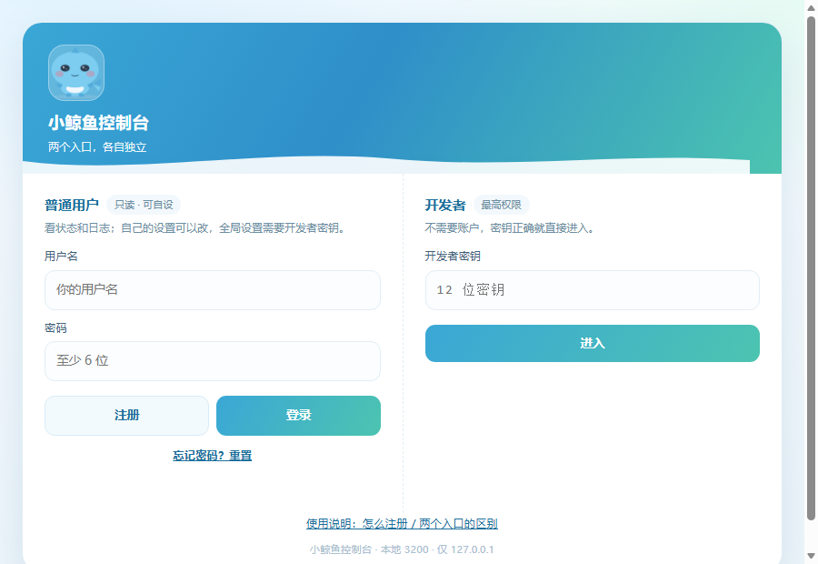
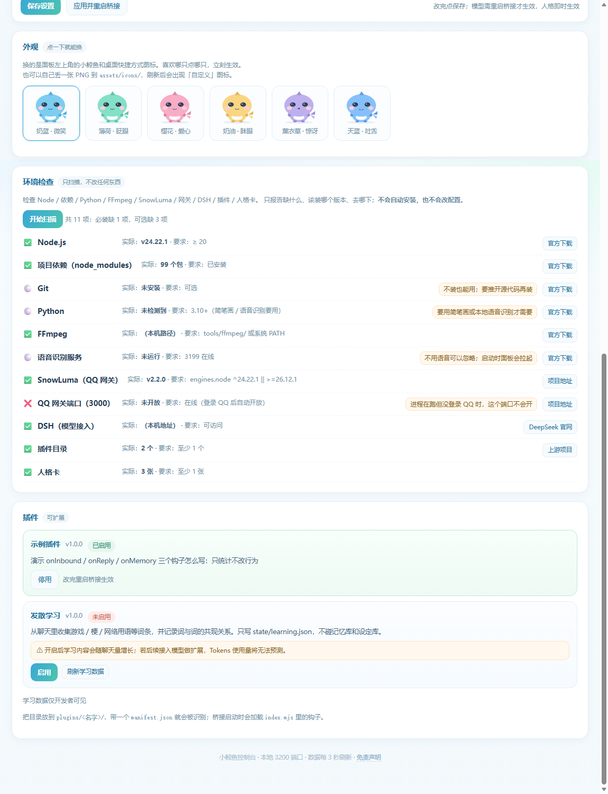
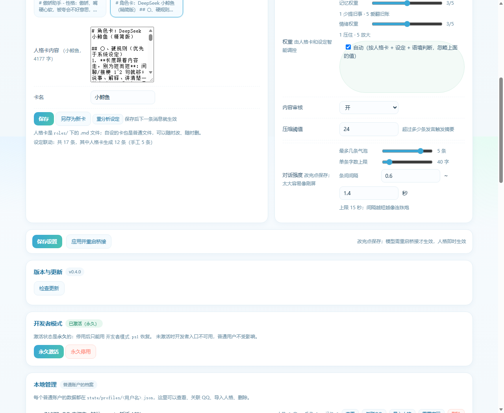
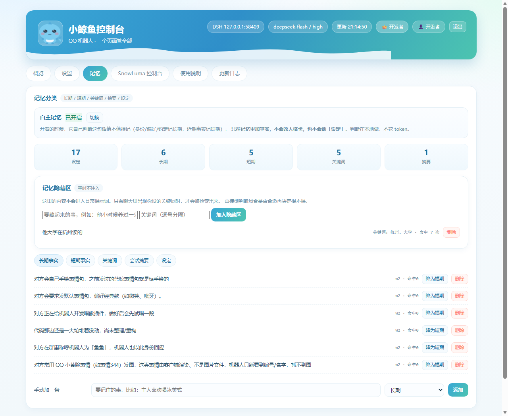
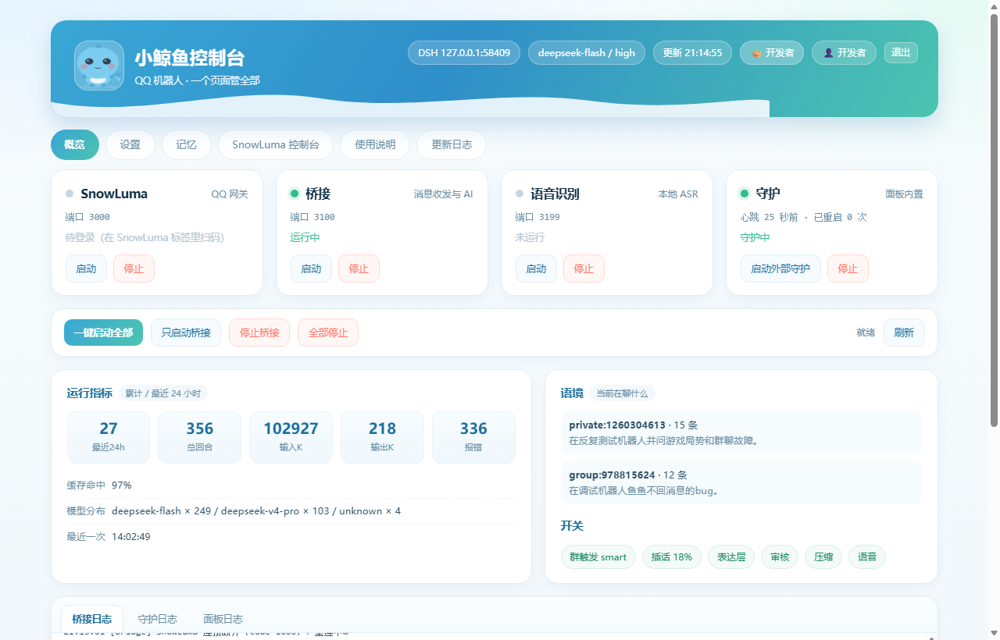

# 小鲸鱼 · deepseek_qq.bot

> 一个能记事、会换表情、还带控制台的 QQ 机器人：能聊天、看得懂图、记得住你，跑在自己的电脑上。

[](https://github.com/WADA115/whale-bot/actions/workflows/ci.yml)
[](LICENSE)




> **先读这个**：本文最后一节「坑」是踩过的真实问题合集，装之前扫一眼能省好几个小时。

---

## 它是什么

```
QQ 消息 → SnowLuma（网关）→ 桥接 → DeepSeek → 回复
                              ↕
                  记忆（按人隔离）/ 语境 / 表达 / 画图
                              ↕
                   控制台 3200 + 反代 5098
```

不是官方产品，是用你自己的 QQ 号在说话，数据全在本机。

---

## 功能

### 聊天
- 私聊直接聊；群聊自己判断接不接（智能 / 只回 @ / 每条都接）
- 按概率主动插话，有冷却；被拍一拍会回戳
- 长句拆成 2~5 条气泡，间隔 0.6~1.4 秒

### 看得懂
图片直读 · 动图抽帧 · 视频抽 4 帧 + 音轨转写 · 语音本地转写（音频不出本机）· 收藏表情包识图

### 记得住（五层 + 按人隔离）
设定（永不删）/ 长期 / 短期（72h 淡出，命中 2 次升长期）/ 关键词 / 会话摘要（超 24 条自动压缩）

- 开发者记忆在 `state/memory.json`；每个普通用户在自己的 `state/profiles/<用户名>/memory.json`
- 记忆以 `<context>` 包在 Prompt 最末尾（Layer 3），并附「不要因为记忆改变人格设定」

### 会学习（插件，默认关闭）
`plugins/learning`：从聊天里收游戏 / 梗 / 网络用语，存 `state/learning.json`，不碰记忆和设定；同句出现的词会两两关联。

### 自主记忆
每条消息用本地规则判断「值不值得记」：身份 / 偏好 / 约定 → 长期，近期事实 → 短期。**不调模型**，但规则是启发式的，**可能误记或漏记**；只写记忆层，不改人格卡和设定。

### 隐藏区与随机回想
- **隐藏区**：平时不注入提示词；出现关键词时会被检索、由模型判断要不要提。面板删除只移除当前记忆库，**历史备份/快照里可能仍保留**。
- **随机回想**：每轮有概率把旧事（含隐藏区）主动带出来，30 分钟冷却、不重复最近 12 条；默认 8%，把 `role.memory.recallChance` 设为 0 可关。

### 会表达
人格卡（卡片式，可自设，保存后自动同步「设定」）· 去 AI 腔 · 情绪影响语气 · 自主补表情包 / 小黄脸 / 颜文字 · 简笔画

### 权重（记忆 / 情绪）

两类信息的影响强度各 1~5，可自动：人格卡（活泼/冷静/念旧）+ 设定（别翻旧账/多关心）+ 语境（技术提问收敛）一起决定。记忆权重控制注入预算与检索条数——**只取和当前话题相关的，不把整库塞进去**；情绪权重控制语气强弱。手动改只限开发者。

### 插件检验性隔离

新插件启用前过「清单校验 + 启发式静态扫描 + 子进程启动检查」：扫描 `child_process` / `eval` / `process.exit` 等字面量，**可被字符串拼接/动态 import 绕过，不是沙箱**；`permissions` 是声明不是强制隔离。桥接只加载「内置白名单」或「已验证」的插件，运行期崩溃由子进程隔离兜底。

运行期插件跑在**独立子进程**里（JSON 行 RPC，单钩子 3 秒超时）：插件死循环、崩溃、`process.exit` 都只影响它自己，桥接记录日志后跳过。

### 检查更新

设置页可查 GitHub Releases 有没有新版本（匿名 API、10 分钟缓存），只提示不自动替换。

### 成长

聊天片段去噪去重后，每天 2 次由模型筛选保留，每周演化一次特质/需求/依恋，阶段从「初识」到「默契」；演化前自动快照、可回滚，影响说话最多 ±20%，可一键关闭。每次演化还会生成一段「自我叙事」，默认所有人可见但群聊/他人私聊先过严格审核（秘密、号码、地址等整句丢弃）；可切「仅主人私聊」或关闭，面板可改可清。

### 守护

桥接和语音识别都有看门狗：每 30 秒探一次（端口 + `/health`），挂了自动拉起；每个服务独立退避（60 秒一次、每小时最多 5 次），失败原因写 `state/logs/watchdog.log` 和 `asr.log`。守护默认无窗口，面板「概览 → 守护」可看状态、停止或重启。

### 情绪强度
1~5 可调（理性 ↔ 感性），也能开「自动」：按心情、消息语气、是否技术提问、人格卡风格一起判断。开发者存全局配置，普通用户存在自己档案里，只影响各自会话。

### 有分寸
出站路径/凭据启发式审核（非分类模型）· 危险工具要管理员确认 · 面板限速与 IP 脱敏

---

## 权限模型：两个入口，互不干扰

| | 普通用户 | 开发者 |
| --- | --- | --- |
| 进入方式 | 用户名 + 密码（可自助注册） | **只填密钥** |
| 设置存哪 | `state/profiles/<用户名>.json` | `config.json` |
| 能改 | 自己的人格、行为、语音开关、受信名单、记忆 | 全部（含本地管理） |
| 能否看全局 | ❌ 403 | ✅ |

- 开发者可永久停用开发者模式（`state/dev-mode.json`），恢复用 `开发者模式.ps1`
- 普通用户档案按账户隔离；但共享同一进程与 `state/` 目录，隔离靠鉴权与路径约束，**不是 OS 沙箱**。环境检查对普通用户自动脱敏。

---

## 快速开始

1. 装 **Node.js ≥ 20**（SnowLuma 自己要求 24+，两个都要满足装 24）
2. `npm install`
3. 复制 `config.example.json` → `config.json`，填 `ownerQQ` / `allow.*` / `snowluma.homeDir` / `dsh.baseUrl`
4. 准备 `tools/`（Windows 版 ffmpeg、ASR 模型；没有也能跑，只是少几种能力）
5. 语音识别单独起：`scripts/ops/start-asr.bat`（自动找 Python 与 onnx 依赖；加 `/silent` 跑后台），或直接让 `scripts/ops/守护.bat` 拉起
6. 启动（Windows 直接双击根目录 `启动.bat`）：
   ```bash
   node app.js          # 面板 3200
   node src/bridge.js   # 桥接 3100
   ```
7. 打开 `http://127.0.0.1:3200` → 填开发者密钥 → 到 SnowLuma 里登录 QQ

第一次启动会自动生成密钥，存在 `state/dev-key.txt`，控制台也打了一行。

---

## 控制台



| 设置 | 记忆 |
| --- | --- |
|  |  |

| 插件 | 登录页 |
| --- | --- |
|  |  |

概览（服务状态 / 指标 / 日志）· 设置（模型、人格、行为、语音、情绪、权重、对话强度、受控名单、账户、开发者模式）· 记忆（五类 + 隐藏区）· 插件（验证状态）· 外观（6 只原创小鲸鱼，点一下换，会眨眼）· 环境检查（只扫不改）· 使用说明 · 更新日志

---

## 配置示例

```json
{
  "ownerQQ": "你的QQ号",
  "allow": { "private": ["你的QQ号"], "groups": ["你的群号"] },
  "gateway": { "type": "snowluma" },
  "snowluma": { "homeDir": "C:\\SnowLuma", "httpUrl": "http://127.0.0.1:3000", "wsUrl": "ws://127.0.0.1:3001" },
  "dsh": { "baseUrl": "http://127.0.0.1:端口" },
  "panel": { "registerPerHour": 20 },
  "role": {
    "groupTrigger": "smart",
    "memory": { "autoRemember": true, "compress": true, "compressAfterTurns": 24 },
    "expression": { "enabled": true, "stickerChance": 0.22, "faceChance": 0.12 }
  }
}
```

换标准 OneBot 网关只改 `gateway.type = "onebot"`，桥接不用动。

---

## 输入限制

用户名 2~24 · 密码 6~128 · 人格卡 20000 字节 · 单条记忆 300 字 · 受信 QQ 每人 50 · 普通账户 20 个 · 注册 20 次/小时（可配）

---

## 目录结构

```
app.js              面板（3200）+ SnowLuma 反代（5098）
启动.bat            根目录一键启动（调用 scripts/ops/start-hidden.vbs）
src/                桥接、记忆、成长、表达、网关
public/             面板与登录页
plugins/            插件（learning / example / growth / DSH 预设）
roles/              人格卡
assets/icons/       外观图标（PNG + ICO，原创）
tests/              自动化测试 + 自检/文档/结构检查脚本
docs/               使用手册、配置说明、部署、截图
scripts/ops/        启动/守护/维护脚本
scripts/            开发探针与历史测试脚本
state/              账户、记忆、日志、备份（不进仓库）
```

---

## 端口一览

| 端口 | 谁 |
| --- | --- |
| 3000 / 3001 | SnowLuma（HTTP / WebSocket） |
| 3100 | 桥接 |
| 3199 | 本地语音识别 |
| 3200 | 控制台 |
| 5098 | 面板给 SnowLuma 起的反代 |
| 5099 | SnowLuma 自带 WebUI |

---

## 安全默认

- 面板只监听 127.0.0.1；未登录只能看登录页与说明页
- 密码 scrypt + 随机盐（N=16384, r=8, p=1, keylen=32）；登录限速；开发者密钥失败指数退避
- 开发者密钥不写进代码：环境变量 → `state/dev-key.txt` → 首次生成
- 普通账户读全局配置 / 记忆 / 本地管理一律 403
- 日志 IP 脱敏；出站内容审核默认开启

---

## 测试

CI 跑离线测试（不依赖面板和网络）：

```bash
node tests/run-offline.mjs
```

<!-- STATS:OFFLINE:START -->
离线测试：42/42 项通过（CI 生成）
<!-- STATS:OFFLINE:END -->

覆盖：记忆分层、多租户隔离、自主判断、语境、表达、审核、表情、网关适配、权限守卫、去重、压缩、智能触发、学习插件、环境扫描、文档渲染、成长、黑话、提示词/消息/发送/插件/投递。

需要外部条件的用例会**自动跳过**而不是报错（API key、`QQB_E2E=1` + 面板在跑）；全量测试在维护者环境运行，数量不写死，以输出为准。

---

## 开源检查

```bash
node tests/check-opensource.mjs "项目目录" "临时输出目录"
```

查敏感串、目录清洁度、必备文件、语法、绝对路径、体积。

---

## 服务器部署

Windows VPS 可整套直搬；Linux 需换 OneBot 网关（NapCat / LLOneBot / Lagrange），桥接不用改。详见 `docs/服务器部署.md`。

---

## 常见坑（完整版见 [FAQ.md](FAQ.md)）

1. **什么都不回** → `ownerQQ` / `allow.private` / `allow.groups` 没填，或改完没重启桥接
2. **桥接刷 WebSocket 错误** → SnowLuma 没登录 QQ，3000 端口本来就不会开
3. **注册/登录 429** → 限速正常，重启面板清零
4. **记忆不对** → 开发者记忆和普通用户记忆是两套文件
5. **语音不发声** → 全局开关 + 个人开关 + 3199 服务 + edge-tts，四样缺一不可

完整 38 条（连不上 QQ、DSH、面板、备份、插件、测试、Windows、二次开发、平台风险）都在 [FAQ.md](FAQ.md)。

## 许可证

MIT。保留上游 qq-bridge / QSH 的版权声明，并附本项目署名。

`assets/icons/` 里的吉祥物随项目 MIT 提供；生成脚本/来源记录待补（见 `assets/icons/PROVENANCE.md`，补齐前不主张“原创”）。

## 致谢

[SnowLuma](https://github.com/SnowLuma/SnowLuma)、[DeepSeek Harness](https://www.deepseek.com/harness/)、[qq-bridge / QSH](https://github.com/Derpyu520/qq-bridge)、sherpa-onnx、FFmpeg、edge-tts、Pillow，以及所有写 OneBot 实现的人。详见 `致谢.md`。

## 免责声明

> ⚠️ **数据默认明文存本机，不加密**：面板一旦被攻破，所有账户的档案/记忆/日志都可读。建议全盘加密、不要把 3200 暴露公网。

见 [免责声明.md](docs/免责声明.md)：AI 内容不保证正确；聊天记录明文存本机；API 费用自付；第三方组件版权归各自作者；封号风险自担。

> 个人项目，用爱发电：不代挂、不收费、不接定制。任何人以本项目名义收费或承诺服务，都与作者无关。
